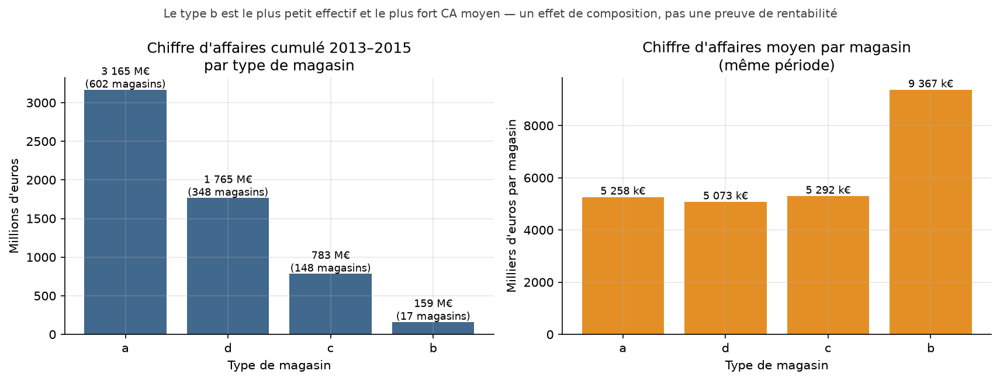
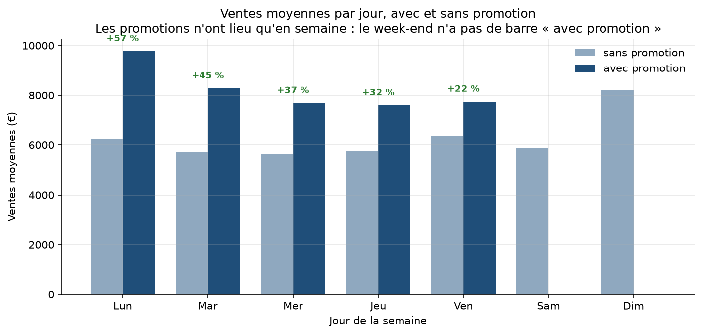
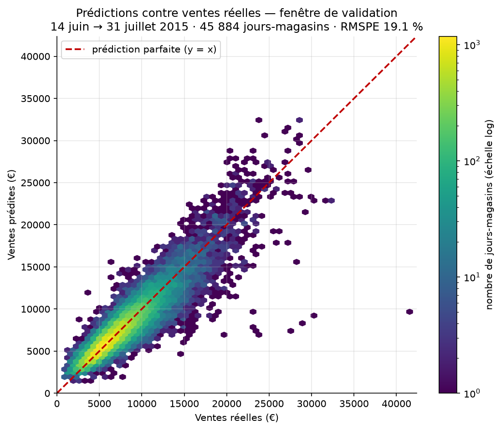
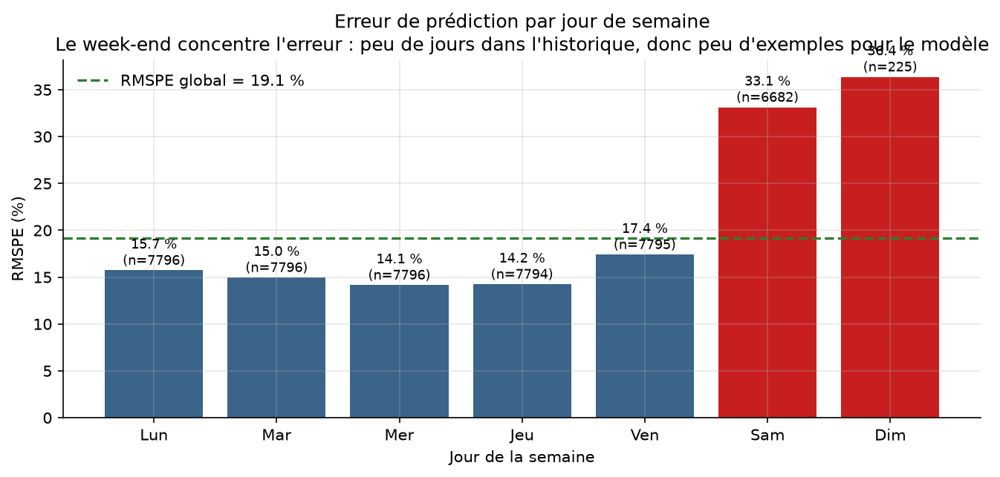
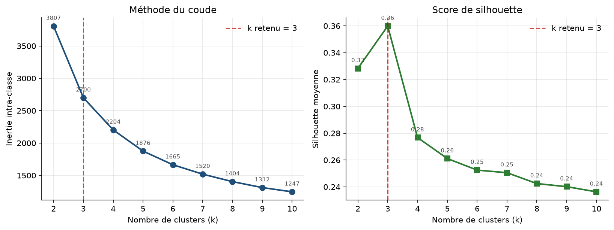
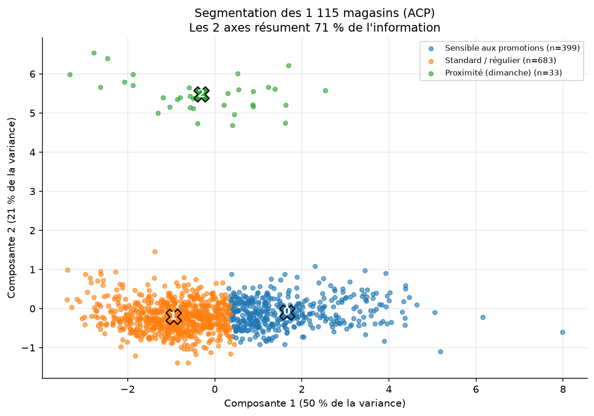
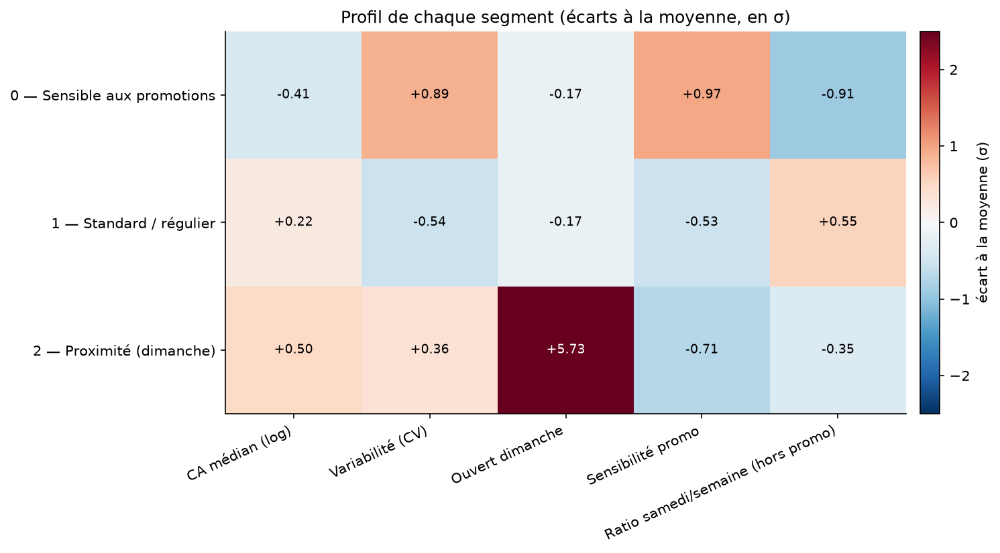
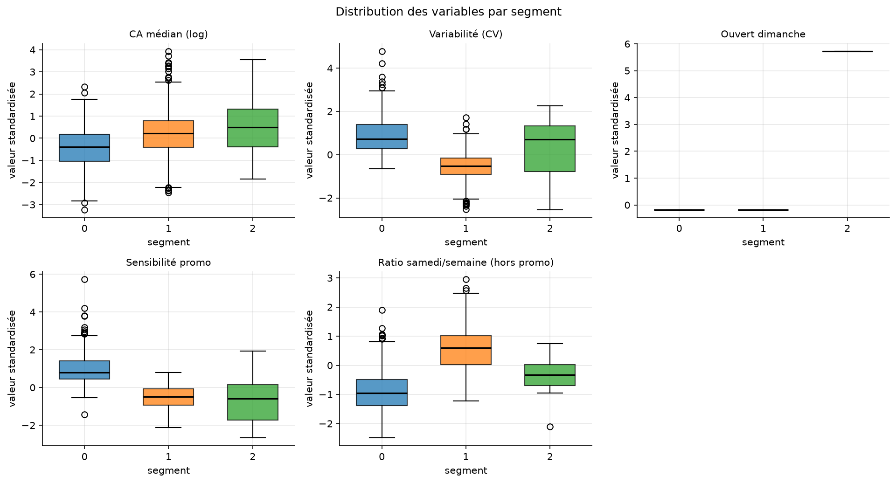
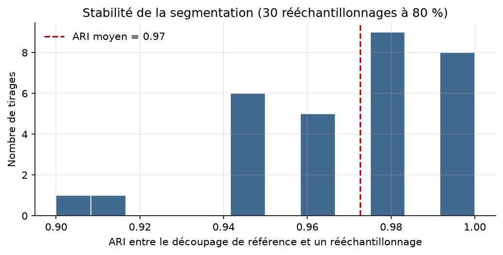
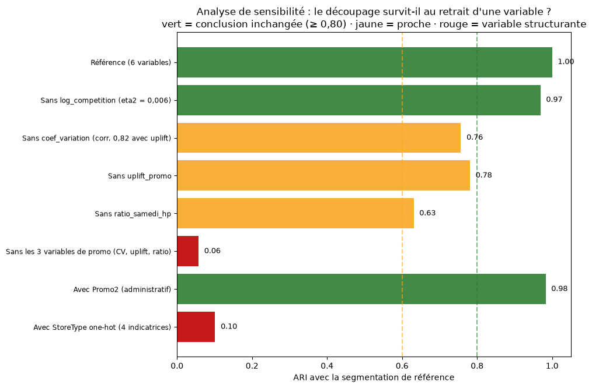

<div align="center">

# Rossmann Store Sales — analyse complète d'un réseau de 1 115 magasins

**SQL · Régression supervisée · Segmentation non supervisée**

De l'exploration d'une base de 1,1 million de lignes à un modèle prédictif
évalué en compétition Kaggle, puis à une typologie de magasins validée.


</div>

---

## Le projet en une minute

| | Résultat |
|---|---|
| **Données** | 1 017 209 lignes d'entraînement, 1 115 magasins, 2013–2015 |
| **Partie 1 — SQL** | 6 analyses sur DuckDB : structure du parc, effet promo, ouverture dominicale, top 5 |
| **Partie 2 — Prédiction** | Ridge sur `log1p(Sales)` : **RMSPE 19,1 %** en validation temporelle, **0,174 au classement privé Kaggle** |
| **Partie 3 — Segmentation** | KMeans + ACP : **3 profils de magasins** identifiés, validés par des variables externes |
| **Point clé** | 2 modèles intermédiaires rejetés après diagnostic, décisions documentées dans [`docs/journal_decisions.md`](docs/journal_decisions.md) |

---

## Sommaire

1. [Contexte et données](#1-contexte-et-données)
2. [Partie 1 — Analyse SQL](#partie-1--analyse-sql)
3. [Partie 2 — Prédiction des ventes](#partie-2--prédiction-des-ventes)
4. [Partie 3 — Segmentation des magasins](#partie-3--segmentation-des-magasins)
5. [Ce que ce projet démontre](#ce-que-ce-projet-démontre)
6. [Reproduire les résultats](#reproduire-les-résultats)
7. [Structure du dépôt](#structure-du-dépôt)

---

## 1. Contexte et données

Rossmann exploite plus de 3 000 drogueries en Europe. Le jeu de données public
couvre **1 115 magasins** sur 942 jours, avec pour chaque magasin et chaque jour :
les ventes, le nombre de clients, l'ouverture, les promotions, les jours fériés
et les vacances scolaires.

L'objectif du concours Kaggle est de prédire les ventes journalières du
1er août au 17 septembre 2015, sur des magasins dont l'historique s'arrête au
31 juillet 2015. Contrainte structurante : **la variable `Customers` n'existe pas
dans le jeu de test**, elle est donc inutilisable comme variable explicative.

**Données non incluses dans ce dépôt** (volumineuses) : `train.csv`,
`test.csv`, `store.csv` sont téléchargeables sur
[la page du concours](https://www.kaggle.com/competitions/rossmann-store-sales/data).

---

## Partie 1 — Analyse SQL

Six requêtes SQL exécutées sur DuckDB, chacune répondant à une question métier
précise. Le détail et les conclusions complètes sont dans
[`sql/conclusions.md`](sql/conclusions.md).

| Question | Résultat |
|---|---|
| Combien de magasins par type, et quel chiffre d'affaires ? | `a` : 602 magasins / 3 165 M€ · `d` : 348 / 1 765 M€ · `c` : 148 / 783 M€ · `b` : 17 / 159 M€ |
| Quel type performe le mieux en moyenne ? | Type `b` : **9,4 M€ par magasin**, contre 5,3 M€ pour `c` et `a`, 5,1 M€ pour `d` |
| Les promotions augmentent-elles les ventes ? | **+38,8 %** en moyenne (8,2 k€ contre 5,9 k€) — écart descriptif, non causal |
| Qui ouvre le dimanche ? | 3 593 lignes magasin-jour, uniquement types `a`, `b`, `d` ; les 17 magasins de type `b` ouvrent tous |
| Quel est le CA moyen du dimanche ? | ≈ 8,2 k€ pondéré — mais c'est un **effet de composition**, pas une preuve de rentabilité |
| Top 5 des magasins | 262, 817, 562, 1114, 251 (de 19,5 à 14,9 M€) |

> **Précaution méthodologique adoptée dans tout le projet** : ces résultats sont
> descriptifs. Le type `b` a le CA moyen par magasin le plus élevé, ce qui ne
> prouve pas sa rentabilité (marges, charges, surfaces inconnues). L'écart
> promotionnel est une association, non une relation causale.

<br>

### Figure 07 — Structure du réseau par type de magasin



> *Deux lectures du même réseau. Le type `b` — 17 magasins sur 1 115 — affiche
> le CA moyen par magasin le plus élevé, mais ne représente que 2,3 % du CA
> cumulé, porté par les types `a` et `d` (950 magasins à eux deux). Confondre
> les deux lectures conduit à des conclusions inverses.*

<br>

### Figure 08 — Le levier promotionnel, jour par jour



> *Les promotions n'ont lieu qu'en semaine — le week-end n'a donc pas de barre
> « avec promotion ». L'écart atteint +39 % en moyenne, mais il varie selon le
> jour : c'est ce constat qui a motivé l'ajout de l'interaction
> `DayOfWeek × Promo` au modèle, laquelle a fait gagner 0,44 point de RMSPE.*

---

## Partie 2 — Prédiction des ventes

### Protocole

- **Cible transformée** : `log1p(Sales)` — stabilise la variance et limite le
  poids des très gros magasins.
- **Validation temporelle** : deux fenêtres futures de 48 jours (la durée exacte
  de la période de test). Jamais de validation aléatoire sur des séries
  temporelles.
- **Périmètre** : jours ouverts avec ventes positives ; les jours fermés sont
  prédits à 0 par convention.
- **Variable exclue** : `Customers`, absente du jeu de test.

### Résultats

| Modèle | Fenêtre 1 (juin–juil. 2015) | Fenêtre 2 (avr.–juin 2015) |
|---|---:|---:|
| Baseline : moyenne historique par magasin | 31,82 % | 29,43 % |
| Ridge one-hot, effets principaux | 21,11 % | — |
| \+ `DayOfWeek × Promo` | 20,67 % | — |
| **\+ `StoreType × DayOfWeek`** | **19,14 %** | **19,67 %** |

**Score Kaggle** : public **0,17005** · privé **0,17384**. L'écart de 0,004 entre
public et privé indique l'absence de sur-ajustement à une sous-période.

Le gain face à la baseline est de **12,7 points de RMSPE** (−40 % en relatif),
stable sur les deux fenêtres — donc structurel, pas un artefact de découpage.

<br>

### Figure 09 — Prédictions contre ventes réelles



> *Le nuage suit la diagonale dans la zone dense (5 000 à 20 000 €), puis se
> **compresse** : au-delà de 25 000 € de ventes réelles, les prédictions se
> tassent autour de 22 000 à 26 000 €, alors que certaines journées atteignent
> 42 000 € — et quelques points très isolés sous-estiment massivement
> (30 000 € réels prédits à 9 000 €). Le modèle linéaire **ramène les cas
> extrêmes vers la moyenne** : c'est la limite visible de l'approche, et
> l'origine d'une partie du RMSPE résiduel. Un gradient boosting corrigerait ce
> point — piste identifiée, non poursuivie.*

<br>

### Figure 10 — Où se concentre l'erreur



> *L'erreur se concentre sur les jours les plus rares dans l'historique. C'est
> exactement ce qui a motivé l'interaction `StoreType × DayOfWeek` (−1,53 point
> de RMSPE), et ce qui éclaire la partie 3 : les magasins ouverts le dimanche
> sont structurellement les plus difficiles à prédire.*

<br>

### Choix méthodologique : les 11 valeurs `Open` manquantes

11 lignes de `test.csv` n'ont pas de valeur `Open`, toutes pour le magasin 622.
Décision : **`Open = 1`**, sur trois indices convergents (taux d'ouverture
historique de 94–100 % du lundi au samedi, dates de test connues toutes
ouvertes, aucune n'étant férié ni vacances scolaires). `test.csv` n'est pas
modifié : l'hypothèse est appliquée en mémoire au moment de la prédiction.

Détail complet : [`docs/resultats_modelisation.md`](docs/resultats_modelisation.md)

---

## Partie 3 — Segmentation des magasins

**Objectif** : identifier des profils de magasins qui se comportent différemment,
pour adapter les politiques commerciales — et non simplement regrouper des
magasins qui se ressemblent.

### Les 3 segments

| Segment | Effectif | CA médian | Variabilité | Sensibilité promo | Ratio samedi | Signature |
|---|---:|---:|---:|---:|---:|---|
| **Standard / régulier** | 683 | 6 804 € | 0,240 | +32 % | 1,13 | activité stable, samedi au-dessus de la semaine |
| **Sensible aux promotions** | 399 | 5 589 € | 0,324 | **+59 %** | 0,76 | petits magasins, semaine dépendante des promos |
| **Proximité** | 33 | 7 394 € | 0,293 | +29 % | 0,90 | type `b` (17/17), trafic ×2,1, panier −30 %, ouvert dimanche |

**Lecture métier** : le segment « sensible aux promotions » est le plus fragile —
plus petit, plus irrégulier, et dépendant d'un levier coûteux en marge. À
l'inverse, le segment « proximité » réalise le CA médian le plus élevé avec la
**plus faible sensibilité promotionnelle** : un modèle de convention de proximité,
où l'on achète sans attendre les promotions.

<br>

### Figure 01 — Choisir le nombre de clusters



> *À gauche, la baisse d'inertie décroche après k = 3. À droite, la silhouette
> atteint son maximum à k = 3 (0,36) puis chute. Deux critères indépendants
> désignent la même valeur.*

<br>

### Figure 02 — Vue d'ensemble des segments



> *Projection ACP des 1 115 magasins. Les deux axes résument une partie seulement
> de l'information : un chevauchement en 2D n'invalide pas la séparation, qui
> s'opère dans les 5 dimensions d'origine.*

<br>

### Figure 03 — Le profil de chaque segment



> *Écarts à la moyenne générale, en écarts-types. Cette figure est le cœur du
> résultat : elle montre quelle variable définit chaque segment. Le segment
> proximité se détache sur l'ouverture dominicale, le segment « sensible aux
> promotions » sur la variabilité et l'élasticité.*

<br>

### Figure 04 — Les distributions, pour vérifier les segments



> *Les moyennes peuvent masquer des recouvrements complets. Ici, les boîtes se
> distinguent réellement sur la sensibilité promotionnelle et la variabilité :
> les segments ne sont pas définis par quelques magasins extrêmes.*

<br>

### Figure 05 — La segmentation est-elle stable ?



> *30 rééchantillonnages à 80 % des magasins, puis mesure de l'accord (ARI) sur
> les magasins laissés de côté. ARI médian 0,983 et minimum 0,900 : le découpage
> se reproduit sur tous les rééchantillonnages, y compris pour le segment
> proximité qui ne compte que 3 % des magasins.*

<br>

### Figure 06 — Analyse de sensibilité des variables



> *Chaque barre représente le même pipeline privé d'une variable. Une barre verte
> signifie que la variable est redondante. Cette analyse a conduit à retirer la
> distance concurrentielle (ARI 0,97 avec un gain de silhouette) et a confirmé
> que réintégrer les indicatrices de type de magasin détruit la segmentation
> comportementale (ARI 0,10).*

<br>

### Validations externes

Les segments ont été confrontés à des variables **jamais fournies à
l'algorithme** — sans quoi la démonstration serait circulaire :

| | Standard | Sensible promo | Proximité |
|---|---:|---:|---:|
| `StoreType` = `a` | 42,5 % | **74,9 %** | 39,4 % |
| `StoreType` = `b` | 0 % | 0 % | **51,5 %** (17/17) |
| Clients / jour | 780 | 658 | **1 388** |
| Panier moyen | 9,86 € | 9,23 € | **6,90 €** |
| `Promo2` (adhésion) | 0,51 | 0,54 | 0,27 |

Le fait que `Promo2` soit **équilibré entre les segments** est un résultat en
soi : une première version du clustering séparait les magasins sur cette seule
adhésion administrative. Le journal des décisions documente ce rejet.

Détail complet : [`docs/journal_decisions.md`](docs/journal_decisions.md) et
[`docs/methodo_clustering.md`](docs/methodo_clustering.md)

---

## Ce que ce projet démontre

**De la donnée brute à la décision, sans sauter d'étape.** Les trois parties
s'enchaînent : le SQL identifie les disparités entre types de magasins, la
modélisation quantifie ce qui pilote les ventes, la segmentation explique
*pourquoi* certains magasins sont plus difficiles à prédire.

**Des choix mesurés plutôt que supposés.** Deux versions du clustering ont été
rejetées après diagnostic (indicatrices de type, puis variable d'adhésion
administrative). Une variable a été retirée alors qu'elle « améliorait » le
résultat apparent. Une hypothèse personnelle a été **contredite par la mesure**
et abandonnée — voir D8 dans le journal des décisions.

**Des limites assumées.** Modèle linéaire unique, pas de modèle par magasin,
segments descriptifs et non prouvés stables dans le temps, segment proximité
de 33 magasins aux statistiques fragiles. Ces limites sont documentées, pas
passées sous silence.

---

## Reproduire les résultats

```bash
# 1. Environnement
python -m venv .venv
.venv\Scripts\activate          # Windows
pip install -r requirements.txt

# 2. Données : placer train.csv, test.csv, store.csv à la racine
#    (téléchargement : https://www.kaggle.com/competitions/rossmann-store-sales/data)

# 3. Partie 1 — SQL
python src/exploration.py

# 4. Partie 2 — Prédiction
python src/modelisation.py       # validation temporelle, écrit submission.csv
python src/verifier_submission.py

# 5. Partie 3 — Segmentation
python src/clustering_final.py   # figures 01 à 05
python src/clustering_sensibilite.py   # figure 06
```

---

## Structure du dépôt

```
rossmann-sales/
├── README.md
├── LICENSE                  # MIT
├── requirements.txt
├── .gitignore               # exclut les CSV, .venv et les sorties de modèle
├── sql/
│   ├── analyse.sql            # 6 requêtes commentées
│   └── conclusions.md
├── src/
│   ├── exploration.py             # audit des données + exécution SQL
│   ├── modelisation.py            # validation temporelle, Ridge, soumission
│   ├── verifier_submission.py     # contrôle du format avant envoi
│   ├── archiver_submission.py     # archive datée d'une soumission
│   ├── clustering_final.py        # segmentation + figures 01 à 05
│   ├── clustering_sensibilite.py  # analyse de sensibilité, figure 06
│   └── figures_parties_1_2.py     # figures 07 à 10
├── docs/
│   ├── resultats_modelisation.md
│   ├── journal_decisions.md
│   └── methodo_clustering.md
└── figures/
    └── 01 à 10.png
```

Les données (`train.csv`, `test.csv`, `store.csv`) ne sont pas versionnées :
voir les instructions de téléchargement ci-dessus.

<details>
<summary>Scripts de travail non publiés</summary>

Les versions intermédiaires du clustering (v0 à v4), qui documentent les deux
fausses pistes explorées, sont conservées hors du dépôt. Leur contenu et les
raisons de leur abandon sont détaillés dans
[`docs/journal_decisions.md`](docs/journal_decisions.md), sections D5 à D8.

</details>

---

<div align="center">

**Nasreddine El Mammeri** — [GitHub](https://github.com/Nasreddine-EL-MAMMERI) · [LinkedIn](https://www.linkedin.com/in/nassreddine-elmammeri/)

Données : [Rossmann Store Sales, Kaggle](https://www.kaggle.com/competitions/rossmann-store-sales)

</div>
